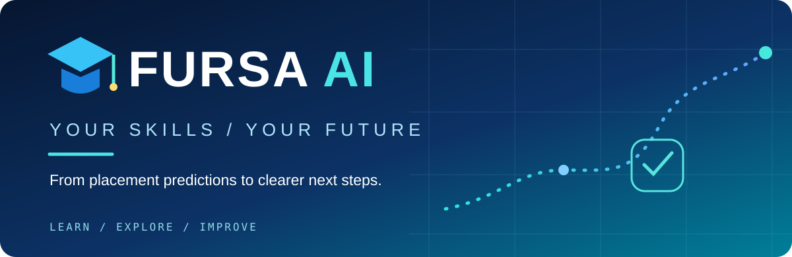
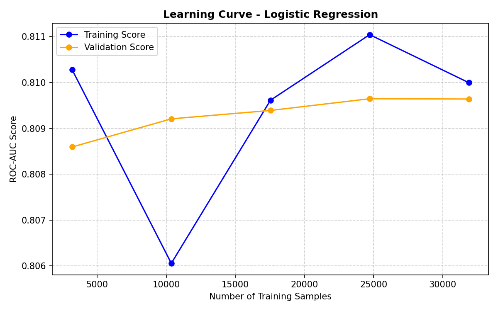

<div align="center">


<br/>

**A machine learning project for student career exploration**

[THE IDEA](#the-idea) &nbsp; / &nbsp; [THE EXPERIENCE](#the-experience) &nbsp; / &nbsp; [THE APPROACH](#the-approach) &nbsp; / &nbsp; [RUN LOCALLY](#run-locally) &nbsp; / &nbsp; [بالعربي](README_AR.md)

</div>

---

<a id="the-idea"></a>
<table><tr><td width="11%" valign="top"><h2>01</h2></td><td>

## A degree is a beginning. Not a roadmap.

Finishing university doesn't always make the next step obvious. Which skills need attention? What can a student improve? Where should they start?

**FURSA AI** explores patterns associated with student placement in a **synthetic dataset**. A bilingual Streamlit application brings a placement-model score and a separate, transparent skill-development guide into one experience.

> **Not “Will I succeed?” — but “What can I work on next?”**

</td></tr></table>

<a id="the-experience"></a>
<table><tr><td width="11%" valign="top"><h2>02</h2></td><td>

## One profile. Several perspectives.

<table>
<tr><td width="50%"><b>PROFILE ANALYSIS</b><br/><sub>Enter 10 academic, technical, practical and professional inputs.</sub></td><td><b>MODEL SCORE</b><br/><sub>See the classifier's score for the dataset's <code>Placed</code> class.</sub></td></tr>
<tr><td><b>SKILL DEVELOPMENT</b><br/><sub>Check eight illustrative educational targets and receive rule-based next steps.</sub></td><td><b>WHAT-IF EXPERIMENTS</b><br/><sub>Try additional projects, internships or programming improvement and compare model scores.</sub></td></tr>
</table>

<sub>Arabic / English interface · Streamlit · Educational exploration</sub>

</td></tr></table>

<a id="the-approach"></a>
<table><tr><td width="11%" valign="top"><h2>03</h2></td><td>

## Inside the model

**DATA → PREPROCESS → COMPARE → SELECT → EXPLORE**

The repository includes the study notebook, a student-career dataset, training outputs, comparison artifacts and the running Streamlit app.

| Component | Implementation |
|:--|:--|
| Target | `Placement_Status` — Placed / Not Placed |
| Data | Synthetic student-career dataset |
| Form inputs | CGPA, programming, problem solving, projects, internships, certifications, communication, English proficiency, resume score, interview score |
| Engineered features | `Soft_Skills_Average`, `Practical_Exposure_Score` |
| Compared algorithms | Logistic Regression, Decision Tree, Random Forest, KNN |
| Application artifacts | `milestone3_outputs/best_placement_model.pkl` and `preprocessor.pkl` |

**Model evaluation is not personal assessment.** The repository contains artifacts from multiple experiments; they must not be mixed as one run. Consult [the comparison file](model_comparison.csv), [nested CV summary](nested_cv_summary.csv), [root metrics](metrics.json) and [Arabic results notes](RESULTS_AR.md) with their respective evaluation context.

<div align="center"><br/><sub>Experiment artifact included in this repository</sub></div>

</td></tr></table>

<a id="run-locally"></a>
<table><tr><td width="11%" valign="top"><h2>04</h2></td><td>

## Run the experience

Use Python **3.11 or 3.12**.

```bash
git clone https://github.com/Ramaalodat/REBUILD_AI1.git
cd REBUILD_AI1
python -m pip install -r requirements.txt
python -m streamlit run app.py --server.port 8502
```

Open **http://localhost:8502**. The application loads its bundled trained model; no retraining is needed for a local demo.

To explore the experiments, open `Fursa_AI_Balanced.ipynb` in Jupyter and execute its cells in order.

<details>
<summary><b>Repository guide</b></summary>

| Path | Purpose |
|:--|:--|
| `app.py` | Bilingual Streamlit experience |
| `Fursa_AI_Balanced.ipynb` | Data preparation and ML experiments |
| `student_career_success_dataset.csv` | Project dataset |
| `milestone3_outputs/` | Saved model, preprocessor and visual artifacts |
| `model_comparison.csv` | Model comparison experiment |
| `metrics.json` | Exported metrics for a reported run |
| `README_AR.md` / `RESULTS_AR.md` | Arabic project and evaluation notes |

</details>

</td></tr></table>

---

<table><tr><td width="11%" valign="top"><h2>05</h2></td><td>

## What this project does *not* claim

The data is **synthetic**, not a representative study of real graduates or the Jordanian job market. The model score is **not** a calibrated employment probability, verified readiness level, or hiring recommendation.

Learning targets and suggestions are **educational rules**, not explanations inferred from the classifier. Changing profile inputs in the simulator demonstrates **model response**, not a causal employment benefit.

The next step is to evaluate with real-world data and, eventually, align guidance with verified job requirements.

</td></tr></table>

---

<div align="center">

### YOUR FUTURE ISN'T PREDICTED. IT'S BUILT.

<sub>FURSA AI — Your Skills / Your Future</sub>

<br/>

**Rama Fathi Mahmoud Arjoub** &nbsp; · &nbsp; **Rama Feras Deifallah Aloudat**

</div>
